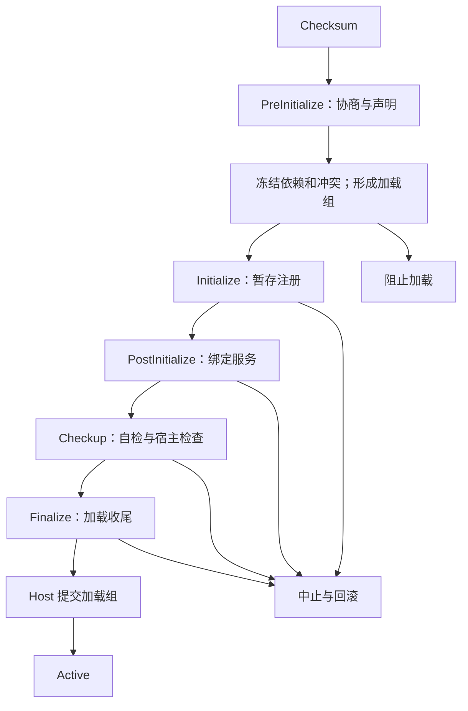

# Historical design proposal

This is design history, not the current implementation reference.

````text
# Nexa PluginSidecar 加载 ABI 设计稿 v0.1

日期：2026-11-10（Asia/Shanghai）
修订：2026-11-10，确认热加载冲突在 Checkup 判失败后执行停用。
修订：2026-11-11，确认已协商能力统一由 ABIContext 提供入口，生命周期保留独立 StageContext。
范围：插件加载、ABI 协商、能力注册、插件间绑定、检查、提交、失败回滚及卸载。
性质：设计提案，可作为实现规格；未读取或修改现有仓库，不代表现有实现已经符合本文。
本文中的“必须”定义这份提案内部的协议要求；用户已确认项与本次补充设计在第 1 节区分。

## 1. 已确认约束与本次设计选择

### 1.1 已确认

1. 加载阶段固定为 Checksum、PreInitialize、Initialize、PostInitialize、Checkup、Finalize。
2. Checksum 由加载器解密插件到内存，验证 SHA 与授权期限。
3. 插件冲突时，冲突双方均阻止加载。
4. 按必需依赖组成的加载组提交；组内失败整体回滚，无关组继续。
5. 独立 PluginSidecar 负责插件加载管理。尚未指定“一插件一进程”，本文不作此推导。
6. 授权期限仅加载时检查，运行过程中不定时复查到期。
7. 稳定 ABI 通过 GetABIContext(version) 请求；version 为 100 的正整数倍。
8. 实验 ABI 通过 GetExpermentABI(EXP_ID) 请求，新能力分配唯一 EXP_ID，下个大版本合入稳定 ABI。
9. 实验 ABI 永久保留兼容支持，不因转正删除旧 EXP_ID 或改变原契约。
10. MakeABIContext 最终请求 Host 确认兼容性；成功返回最终 ABIContext，失败返回 ABI_FALSE，并提供结构化失败原因。
11. 全部已协商能力按组统一放入 ABIContext。Initialize、PostInitialize、Checkup、Finalize 接收同一个最终 ABIContext 与独立 StageContext，不再分别传入 EventAbility、UiAbility、InterPluginAbility。
12. Checkup 执行插件自检、统计错误并发送遥测；Finalize 执行加载收尾。
13. 热加载与已 Active 插件发生冲突时，先由宿主将本次 Checkup 判为失败，再停用已运行的冲突插件及直接、间接必需依赖它们的运行中插件；新加载组不提交。
14. 能力入口统一不改变阶段约束：服务通过 abi.Plugins 在 Initialize 声明，在 PostInitialize 绑定；普通业务在 Active 调用。实验访问器仅返回 Make 已确认的实验能力，不再次协商或授权。

### 1.2 本次补充设计

- 引导协议 Bootstrap 1 与业务 ABI 100/200/…分开编号。
- ABI_FALSE 是无效句柄 0；Get 返回的上下文处于 Draft，Make 返回 Ready 上下文。
- 所有请求对象绑定加载实例；最终 ABIContext 不可变。
- 使用稳定的 UTF-8 JSON 消息封套作为 ABI 100 的初始跨进程编码；抽象传输不依赖具体 IPC 库。
- 托管插件使用冻结的 Bootstrap 契约程序集；原生入口作为同语义适配方案，不要求本期实现。
- UI、事件、服务注册暂存，Finalize 全组成功后由 Host 原子发布。
- 具体超时、限额、错误码与接口签名是本次建议默认值，可调整而不改变上述已确认原则。

## 2. 三方职责与三种版本

| 参与方 | 权限与职责 | 不拥有的职责 |
| --- | --- | --- |
| Host | 最终兼容性裁决、授权检查、能力授权、注册目录、提交决策、UI 呈现、遥测策略 | 不在主进程执行插件生命周期代码 |
| PluginSidecar | 获取加载许可、解密/校验、实例加载、调度回调、错误捕获、依赖规划、调用适配 | 不能绕过 Host 自行宣布上下文 Ready 或组 Active |
| Plugin | 请求 ABI、声明冲突依赖、注册内容、绑定服务、自检和收尾 | 不能修改宿主判定结果、伪造其他插件身份或提交注册 |

Host 可委托 Sidecar 完成校验计算，但 Host 接受的结果必须绑定本次会话、插件身份和验证后的内容摘要。

版本必须分离：

| 字段 | 示例 | 用途 |
| --- | --- | --- |
| bootstrapVersion | 1 | OnPreInitialize 等稳定入口及协商基本类型 |
| transportVersion | 1 | Host ↔ Sidecar 消息封套与编码 |
| stableAbiVersion | 100、200 | EventAbility、UiAbility 等业务能力契约 |
| expId | 固定 128 位 ID | 单个实验接口族及其不可变契约 |
| serviceContractVersion | 1 | 插件间服务自己的版本 |
| pluginVersion | 1.4.2 | 插件发布版本，与 ABI 版本无数学映射关系 |

Host 产品版本与 stableAbiVersion 不必同步递增。本文“下个大版本合入”指下一次稳定 ABI 大版本发布，例如 100 → 200。

## 3. 标识、基础类型与句柄

### 3.1 标识

- PluginId：发行后固定、区分大小写的规范 ASCII ID，例如 nexa.example.plugin。
- PluginVersion：规范 SemVer 字符串；依赖范围在结构化字段中表达，拒绝有歧义的自定义表达式。
- ContentDigest：验证后的插件包清单及负载摘要标识。
- LoadInstanceId：每次实际重新加载分配的 128 位随机 ID；Sidecar 重启后重新生成。
- SessionId：本次 Host/Sidecar 连接的 128 位随机 ID。
- LoadGroupId：本轮必需依赖连通组 ID。
- EXP_ID：128 位全局唯一 ID；永不回收、永不赋予新的不兼容语义。

### 3.2 基本返回规则

逻辑接口中的 ABIContext、ExperimentRef、RegistrationHandle 等，底层均为不透明 64 位句柄：

- 0 = ABI_FALSE；任何有效句柄均非 0。
- 每类句柄分开校验，禁止把 ExperimentRef 当 ABIContext。
- IPC 中将 64 位句柄编码为固定 16 字符小写十六进制字符串，避免 JSON 数值精度问题。
- 不通过 IPC 传递对象地址、函数地址、GC 对象引用、操作系统裸句柄或可直接解引用的指针。
- Host/Sidecar 根据连接实际身份绑定请求，不能只相信消息中的 pluginId。
- 句柄必须匹配 sessionId、loadInstanceId、对象类型和当前状态。
- 句柄失效后不在同一会话复用；迟到请求返回 HANDLE_EXPIRED。
- 句柄是 API 路由与权限检查手段，不把共享进程里的对象隔离当成安全沙箱。

基础结果类型：

```csharp
// 以下为语言无关契约的 C# 表达；签名用作 SDK 设计，不是实现代码。
record AbiError(
    string Code,
    string Message,
    string Stage,
    string Operation,
    string PluginId,
    string LoadInstanceId,
    string CorrelationId,
    bool Retryable,
    IReadOnlyDictionary<string, string> Details);

record AbiReply<T>(T Value, AbiError? Error);
// 成功：Error == null。
// 失败：句柄类 Value == ABI_FALSE，Error != null。
// 空结果使用 Unit；不使用异常跨越 ABI 边界。
```

失败原因与响应一起返回，不能只依赖一个全局 LastError。SDK 可以提供便利的 GetLastABIError，但它不是协议的权威错误来源，也不能供并发调用共享。

### 3.3 对象所有权

GetABIContext、GetExpermentABI 返回对象由本次加载会话登记。Make 成功后，最终上下文持有必要的扩展引用；释放请求句柄不影响已确认上下文。加载结束或失败时 Sidecar 自动回收未使用请求对象。

插件不得自行构造、编辑或序列化 ABIContext 的内部字段。可读取的 AbiContextInfo 是快照，不是授权凭据。

## 4. 包清单、Checksum 与加载许可

### 4.1 最小清单

```json
{
  "manifestVersion": 1,
  "pluginId": "nexa.example.plugin",
  "pluginVersion": "1.0.0",
  "bootstrapVersion": 1,
  "entry": {
    "kind": "managed",
    "assembly": "Example.Plugin.dll",
    "type": "Example.Plugin"
  },
  "target": {
    "os": ["windows", "linux", "macos"],
    "arch": ["x64", "arm64"]
  },
  "declaredAbiCandidates": [200, 100],
  "dependencies": [],
  "conflicts": [],
  "requestedPermissions": [],
  "payloads": [
    {
      "path": "Example.Plugin.dll",
      "size": 12345,
      "sha256": "<64 lowercase hex characters>"
    }
  ]
}
```

declaredAbiCandidates 是兼容性提示和请求边界，不取代 OnPreInitialize 协商。入口、引导版本、平台架构和受信清单必须在执行插件代码前检查。目标运行时能力也必须由清单准确表达，不能仅靠操作系统/架构判断可执行性。

### 4.2 流程

1. 读取包头并检查格式、尺寸上限、加密元数据、清单可信性。
2. Host 检查授权主体、插件 ID、内容/版本范围、有效起止时间及授权证据，签发本次 LoadPermit。
3. 由凭据提供器获取解密材料，Sidecar 解密到受控数据缓冲区；密钥不传给插件。
4. 完成认证解密验证，再按清单对每项负载验证 SHA-256；明文摘要必须与可信清单绑定。
5. 检查全部声明依赖文件、路径规范、重复条目、解压尺寸和入口引导兼容性。
6. 绑定 LoadPermit 与实际 ContentDigest，通过后才加载可执行内容、创建插件实例。
7. 尽早清除不再使用的密钥与临时明文缓冲；不宣称这能阻止进程内内存提取。

Checksum 是宿主控制阶段，不设 OnChecksum 插件回调。

如果授权检查依赖网络而无法完成，明确返回 AUTHORIZATION_UNAVAILABLE；不能默认为过期，也不能自行默认允许。可信离线授权票据如果存在，可按签发的离线策略验证；没有票据则失败，不自动增加宽限期。

授权在本次加载获得许可后不再按墙钟到期撤销。Sidecar 崩溃后的重载、插件升级和显式重载都是新加载，必须重新执行 Checksum 和授权检查。尚未提交就失败的加载许可不能跨新实例复用。

“内存加载”是包负载验证和受支持的托管程序集加载要求。包含必须经文件路径加载的原生依赖时，不得悄悄落盘；该类包在当前内存加载配置下返回 PAYLOAD_KIND_UNSUPPORTED，除非另行设计并明确允许缓存策略。

## 5. 冻结的 Bootstrap 1 契约

Bootstrap 只含：基础结果、有限数据记录、回调、取消/截止时间、协商入口、ABIContext 的稳定能力查询门面、生命周期结果与最小引导诊断/清理能力。
不能引用业务 ABI 200 才存在的类型，否则旧插件可能在协商前就加载失败。

```csharp
interface IPluginBootstrapV1
{
    ValueTask<AbiReply<PreInitResult>> OnPreInitialize(
        PreInitContext context);

    ValueTask<AbiReply<Unit>> OnInitialize(
        ABIContext abi,
        StageContext stage);

    ValueTask<AbiReply<Unit>> OnPostInitialize(
        ABIContext abi,
        StageContext stage);

    ValueTask<AbiReply<CheckupResult>> OnCheckup(
        ABIContext abi,
        StageContext stage);

    ValueTask<AbiReply<Unit>> OnFinalize(
        ABIContext abi,
        StageContext stage);

    ValueTask<AbiReply<Unit>> OnAbort(
        AbortContext context);

    ValueTask<AbiReply<Unit>> OnStop(
        StopContext context);
}
```

ABIContext 是同一实例持有的本地上下文封装；底层标识仍是不透明 ABIContext 句柄，不能通过 IPC 传递本地封装对象。Bootstrap 仅冻结 Info、GetAbility 和 GetExperiment 等基础入口，不把所有业务方法固定到一个会不断增长的 CLR 接口中。

EventAbility、UiAbility、InterPluginAbility 等能力由 ABIContext 查询获得；SDK 提供 abi.Events、abi.UI、abi.Plugins、abi.Diagnostics、abi.Resources 强类型视图。其契约版本严格匹配 Make 确认的集合，不能默认绑定 Host 最新版本。

```csharp
// 稳定基础门面；业务属性是 SDK 包装，不要求向此接口增加成员。
interface ABIContext
{
    AbiContextInfo Info { get; }
    AbiReply<IAbilityV1> GetAbility(string contractId);
    AbiReply<IAbilityV1> GetExperiment(ExpId id, string contractId);
}

interface IAbilityV1
{
    AbiContextHandle Context { get; }
    ValueTask<AbiReply<AbiValue>> Invoke(
        string contractId,
        uint methodId,
        AbiValue arguments,
        InvocationOptions options);
}
```

AbiValue 是封闭的数据联合：Null、Bool、Int64、UInt64、Float64、UTF8String、Bytes、Array、Map。传输使用带类型标签的编码：Int64/UInt64 用十进制字符串，Bytes 用 Base64；Map 仅字符串键，拒绝重复键与未知类型标签。它不承载任意 CLR 对象、异常、委托或反序列化类型名。

回调实现由 Sidecar 本地表登记为 CallbackHandle，传给 Host 的只有该句柄及契约 ID。Host 通过 Sidecar 分发回调，托管委托不跨进程。

托管端建议仅将冻结 Bootstrap 程序集共享给各插件加载上下文；插件业务 SDK 和私有依赖按其版本解析。此项需要在现有程序集加载器实现时核实。

### 5.1 PreInitContext / StageContext

```text
PreInitContext
  Identity: PluginId, PluginVersion, LoadInstanceId
  Bootstrap: BootstrapVersion
  Negotiator: GetABIContext / GetExpermentABI / MakeABIContext
  Diagnostics: ReportDiagnostic
  Resources: 最小清理登记能力
  Cancellation: 取消信号
  Deadline: 宿主定义的剩余执行预算

StageContext
  Identity
  Stage
  StageInvocationId
  LoadGroupId
  CheckupInfo: 仅 Checkup 提供的只读检查输入，可空
  Cancellation
  Deadline
```

Bootstrap 的最小诊断和清理能力在 Make 之前可用；这是获得最终 ABIContext 前的引导入口，不因此提前开放业务能力。Make 后的能力统一从 ABIContext 获取。

ABIContext 的版本、实验集合、权限和身份不可变，并存活至本次加载实例结束。当前阶段由 Host/Sidecar 的生命周期状态机维护，不通过修改上下文来切换能力。每次生命周期调用分别创建 StageContext；其中取消信号、截止时间及 StageInvocationId 只对应本次回调，不保存在长期 ABIContext 中。

阶段限定操作除校验当前实例状态外，还绑定有效的 StageInvocationId。SDK 在阶段调用作用域内携带它；回调返回即失效，插件保存旧 StageContext 不能在稍后补注册。运行期操作使用运行期调用预算，不复用已经结束的加载阶段期限。Info 中的版本与权限描述是只读信息，不能代替宿主侧授权检查。

OnAbort 仍接收 AbortContext，其中可带已经确认的 ABIContext；协商失败时允许为空。OnStop 的 StopContext 包含原实例 ABIContext。退出阶段仅允许清理、解绑和诊断等对应操作，不能通过保存的上下文继续正常业务。

### 5.2 生命周期结果

PreInitResult：
- finalContext：本实例唯一 Ready 上下文。
- requiredDependencies / optionalDependencies：动态追加条件。
- conflicts：动态追加冲突。
- declaredDegradationModes：本实例支持且用户/Host 策略可接受的降级项。

CheckupResult：
- status：Passed / Degraded / Failed。
- findings：结构化诊断。
- enabledDegradationModes：实际采用的、前面已允许的降级项。

清单静态必需依赖、权限和冲突不能被回调删除或放宽。动态声明只能追加/收紧；在 PreInitialize 返回后冻结。

## 6. ABI 协商接口

### 6.1 GetABIContext

```text
GetABIContext(uint32 version)
    -> AbiReply<ABIContext>
```

- version > 0 且 version % 100 == 0。
- 可用时返回 Draft 上下文；不可用返回 ABI_FALSE + ABI_VERSION_UNSUPPORTED。
- 非法数字返回 ABI_VERSION_INVALID。
- Get 不返回“最近版本”；100 请求必须得到 100 的契约。
- Draft 只允许查询描述、组合实验扩展、Make 和释放，不能用于业务调用。
- 同一次 PreInitialize 可尝试多个候选版本；插件必须为每个候选实现对应逻辑。
- 不提供隐式版本回退；最终成功时仅一个基础 ABI。

### 6.2 GetExpermentABI

保留用户给定拼写 GetExpermentABI，不在协议里擅自改名。

```text
GetExpermentABI(EXP_ID id)
    -> AbiReply<ExperimentRef>
```

返回描述包含：

```text
ExpId
ContractDigest
SupportedBaseAbis
RequiredExperiments[]
ConflictingExperiments[]
RequiredPermissions[]
SupportedPlatforms
PromotedStableAbi: 可空，仅描述首次合入版本
Lifecycle: Experimental | Promoted
```

- 获取实验引用不会自动启用它。
- 不支持该 ID 返回 ABI_FALSE + EXP_UNKNOWN。
- 已合入的旧 ID 仍返回兼容描述，不因为 Promoted 状态返回失败。
- 不兼容修改必须分配新 EXP_ID；旧 ID 的行为和数据布局保持不变。
- Get 可返回一个可识别但不适用于最终基础 ABI 的扩展；Make 负责组合检查。
- 必需扩展取不到时插件应失败；可选扩展取不到时由插件显式省略，并调整自身功能。
- 取得描述并不等于授予权限。

### 6.3 MakeABIContext

```text
MakeABIContext(
    ABIContext draft,
    ExperimentRef[] experiments,
    MakeOptions options)
    -> AbiReply<ABIContext>
```

MakeOptions v1：
- operationId：本次 Make 尝试的唯一 ID，用于传输去重。
- requestedPermissions：插件清单允许范围内的实际权限子集。

Make 请求由 Sidecar 发给 Host，Host 必须验证：

1. Draft、全部 ExperimentRef 与本次加载身份一致且有效。
2. 基础 ABI 在 Host 和 Sidecar 的实际能力交集中。
3. EXP_ID 契约摘要与兼容实现匹配。
4. 实验支持该基础 ABI、运行平台和必要资源。
5. 实验依赖完整，无互斥组合。
6. 权限已获批准，不超出清单请求。
7. 插件仍处于 PreInitialize，尚未存在另一个 Ready 上下文。
8. LoadPermit 对本次加载有效；此处不重新按当前时间进行授权到期检查。

Make 全部成功时返回一个新的 Ready ABIContext，Draft 标记为 consumed。失败时返回 ABI_FALSE + 精确错误，Draft 仍可用于修正组合后重试。不会部分启用、自动剔除扩展或静默降低版本。

相同 operationId 与相同内容的重试返回同一结果。相同 operationId 配不同内容返回 REQUEST_ID_REUSED。修改实验组合后必须使用新 operationId。网络结果未知时，先查结果或按相同 ID 重试，不能盲目重新创建上下文。

同一实例一旦 Make 成功，其他 Draft 不可再次 Make；返回 CONTEXT_ALREADY_CONFIRMED。确定性失败可在 PreInitialize 内调整候选；结果未知不等于失败。

Ready 上下文绑定：
- PluginId / LoadInstanceId / SessionId。
- stableAbiVersion。
- 已确认实验扩展集合及 ContractDigest。
- 已授权权限集合。
- Host/Sidecar 适配实现标识。
- LoadPermitId 和协议摘要。

### 6.4 永久兼容的具体承诺

EXP_ID 永久保留不仅是目录保留。对于曾受支持的“基础 ABI + EXP_ID”组合，后续 Host/Sidecar 发布必须保留对应实现或语义等价适配器。实验依赖的旧基础语义也必须可用，不能因删除基础 ABI 间接让 EXP_ID 失效。

例如 EXP_X 在 ABI 100 上可用并于 ABI 200 合入：
- 100 + EXP_X 永久走原契约。
- 200 使用该功能时不必申请 EXP_X。
- 200 + EXP_X 是否可用，由该实验明确的兼容映射决定；不得只凭同名就接受。
- 若支持 200 + EXP_X，其旧入口与新入口对同一逻辑能力不得重复注册。

永久兼容不表示所有未来实验组合都必须兼容，也不消除平台条件、权限、实际资源和授权失败。
安全修复可保留兼容语义更新实现；若未来必须禁用某契约，那是对本承诺的显式产品策略变更，不能伪装成普通版本不支持。

### 6.5 最终上下文的能力访问

| SDK 入口 | 返回内容 | 访问规则 |
| --- | --- | --- |
| abi.Info | 版本、身份、确认的实验集合和能力描述 | 只读；Draft 仅可查看协商描述 |
| abi.Events | EventAbility 视图 | 仅包含当前稳定 ABI 的事件契约 |
| abi.UI | UiAbility 视图 | 仅包含当前稳定 ABI 的 UI 契约 |
| abi.Plugins | InterPluginAbility 视图 | 同一入口用于声明、绑定、探测和调用，按方法检查阶段 |
| abi.Diagnostics | DiagnosticAbility 视图 | 报告和查询方法各自遵守阶段限制 |
| abi.Resources | ResourceAbility 视图 | 统一的资源登记与清理归属 |
| abi.GetAbility(contractId) | 已确认的能力门面 | 不授予额外版本、扩展或权限 |
| abi.GetExperiment<T>(EXP_ID) | 已确认实验接口的强类型视图 | SDK 从 T 映射契约 ID，再调用稳定的 GetExperiment(id, contractId) |

GetAbility/GetExperiment 是读取最终上下文能力集合的访问器，不再次执行 Make，也不修改权限或扩展集合。Draft 查询业务能力返回 CONTEXT_NOT_READY；未确认的契约返回 ABI_CONTRACT_NOT_NEGOTIATED，未确认的实验 ID 返回 EXP_NOT_NEGOTIATED。实验 ID 已确认但请求的接口不属于它，或强类型包装模式不匹配，返回 ABI_CONTRACT_MISMATCH。

所有扩展契约必须经过同一检查，不能用 GetAbility 绕过 GetExperiment 的实验确认条件。能力可以按需建立本地代理，无须在 Make 时创建所有实现对象。代理可随实例保存，但每次调用仍检查上下文有效性、权限和当前阶段；不能以“已经拿到代理”绕过检查。

尚未正式发布的当前设计稿将服务导出由 EventAbility 移至 InterPluginAbility。冻结正式 ABI 100 后不得再用这种方式修改已有契约；未来变更需按实验/新稳定版本流程处理。

## 7. 六阶段加载与阶段屏障



图中的组规划、提交与回滚是加载器内部步骤，不新增正常加载回调。任何执行阶段失败也都适用统一失败规则。

### 7.1 调度

1. 同一轮候选先完成 Checksum。
2. 通过者执行 PreInitialize；每个插件在这里完成 Make。
3. 全部候选结束 PreInitialize 后冻结动态声明，构建统一快照，计算冲突、依赖、组。新候选之间的冲突按加载前阻止处理；热加载候选与 Active 实例之间的冲突只登记为待 Checkup 裁决，不能因此提前停用运行中插件。
4. 各有效组可并行推进，但一个组所有成员 Initialize 成功后才进入 PostInitialize。
5. PostInitialize 绑定只访问已经声明完成的组内服务和已 Active 的外部服务。
6. Checkup 之后才调用 Finalize；整个组 Finalize 成功后才请求提交。
7. 无关组的失败、遥测和慢操作不得无界阻塞其他组。

每实例生命周期回调串行且不可重入。不同插件可并行，但不能依赖同阶段的执行先后。ABI 本身不承诺业务回调运行在 UI 线程。

### 7.2 冲突、依赖与加载组

冲突匹配 PluginId + 规范版本范围 + 可选原因码。只要 A 声明与 B 冲突且版本匹配，就对双方生效，不要求 B 对称声明。

在同一个冻结候选快照上计算所有冲突边，再一次性标记所有端点。A–B、B–C 同时存在时，A/B/C 都阻止；不能先删除 B 后再使 A/C 复活。此处新候选间冲突可立即阻止继续初始化；与 Active 实例的热加载冲突按第 7.3 节先登记、到 Checkup 判失败并停用，不混用两个处理时点。

必需依赖形成有向图。提案默认：
- 同轮必需依赖的弱连通分量形成原子加载组。
- 任一成员失败，包括冲突、ABI 协商失败或 Checksum 失败，包含它的已知必需依赖组不能提交；失败前未能取得动态依赖的插件没有可用动态声明。
- 对已通过成员，从静态/已返回动态依赖中计算失效传播，不能假设失败插件返回了完整依赖信息。
- 缺少、版本不满足或被阻止的必需依赖，使依赖方失败。
- 可选依赖不合并组；不存在或尚未 Active 时返回不可用，不阻止加载。
- 必需依赖环允许作为同组声明与绑定环；初始化阶段禁止执行彼此业务方法，因此不以递归初始化解析环。
- 已 Active 的依赖作为外部锚点，不因新依赖方加载失败回滚既有实例；它失效时阻止新组提交。

依赖图必须同时记录身份、版本和加载实例，避免绑定旧实例后在提交前被替换。

### 7.3 已运行插件发生新冲突

初次加载按“双方阻止”处理。热加载规则已确认，必须遵循“Checkup 失败，然后停用”的顺序：

1. PreInitialize 汇总冲突声明，登记与 Active 实例之间的潜在冲突；既有插件此时继续运行。新插件仅进行暂存声明和绑定，不开放正常业务。
2. 新加载组到达 Checkup 时，由 Host 对当前 Active 实例和版本重新验证冲突。插件 OnCheckup 自报 Passed 不能覆盖宿主的冲突结果。
3. 确认冲突后，Host 先记录 Checkup = Failed，根因 PLUGIN_CONFLICT，绑定冲突双方的 PluginId、版本及 LoadInstanceId；新加载组不得进入 Finalize 或提交。
4. 记录失败后，封闭运行中冲突插件及其必需消费者的新调用入口，执行受控停用。受影响集合为冲突插件，加上在当前运行依赖图中直接或间接必需依赖它们的全部 Active 实例；不沿依赖边反向扩展到它们依赖的无关提供方。
5. 新加载组执行 OnAbort 并撤销全部暂存注册；已运行的受影响实例走 Quiescing → OnStop → 资源撤销。两类清理都在 Checkup 失败记录之后启动，不要求它们的完成顺序相同。
6. 新旧冲突双方最终记录为 BlockedConflict；运行中的必需消费者记录停用原因为 DEPENDENCY_FAILED。可选消费者收到提供方不可用通知，按已声明逻辑降级；无关插件继续运行。
7. 若停用失败，补充 CONFLICT_STOP_FAILED，保持相关入口被封闭，并隔离受影响运行会话；新插件始终不启用。原 Checkup 冲突失败不能被后续清理错误覆盖。

若新插件在 Checksum、PreInitialize、Initialize 或 PostInitialize 因其他原因失败，没有到达 Checkup，则不因此前登记的潜在冲突提前停用旧插件。Checkup 时目标已卸载或已更换成不冲突的版本，不对过期的实例快照执行停用。

停用请求绑定 LoadInstanceId，具备幂等性；处理依赖闭包时短暂冻结相关实例的新增绑定，避免新消费者在停用期间接入。依赖环全体先关闭入口，再进行有界清理。

不能把“保留旧插件，只拒绝新插件”称为遵守双方阻止。共享 Sidecar 无法强停单个卡死插件时可能需重启整个进程；影响范围必须报告。自动重启不得把仍被冲突阻止的插件重新启用。

## 8. ABI 100 的能力契约

### 8.1 通用方法规则

每个能力方法均有不可变 ContractId + uint32 MethodId + 参数/结果数据模式。业务方法 ID 仅在所属契约内唯一。新方法不得改变旧方法的参数顺序、字段含义或错误语义。

固定能力契约：
- nexa.events/100
- nexa.ui/100
- nexa.interplugin/100
- nexa.diagnostics/1
- nexa.resources/1

新增能力先通过实验 ContractId + EXP_ID 暴露，下个稳定版合入相应新版本契约。仅透传扩展字段不能被当成增加稳定 ABI 行为的后门。

### 8.2 EventAbility（abi.Events）

| MethodId | SDK 方法 | 阶段 | 作用 |
| --- | --- | --- | --- |
| 1 | DeclareEvent(EventDeclaration) | Initialize | 声明插件发布的事件及负载模式 |
| 2 | Subscribe(EventSubscription) | Initialize | 暂存订阅，Active 后分发 |
| 3 | 保留，不可调用 | — | 此槽位不再提供服务导出 |
| 4 | Publish(EventHandle, Payload, Options) | Active | 发布业务事件 |
| 5 | Unsubscribe(RegistrationHandle) | Active / Stop | 撤销本插件订阅 |

服务统一通过 abi.Plugins.ExportService 声明。EventAbility 仅负责事件，不再承担服务导出。

EventDeclaration：
- name：PluginId 命名空间内唯一。
- payloadSchemaId / payloadSchemaDigest。
- delivery：ABI 100 固定 BestEffortAtMostOnce，不保证进程崩溃后持久投递。
- maxPayloadBytes、队列限额。

EventSubscription：
- sourcePluginId / eventName / schemaId。
- handler：本实例 CallbackHandle。
- required：若为必需跨插件来源，必须与冻结的必需依赖一致。
- 并发度与队列限额。

单个订阅默认串行 FIFO（以接收顺序为准），不同发布者无全局顺序；队列满返回 BACKPRESSURE，不无限堆积。初始化阶段发生的普通外部事件不缓存补发给尚未 Active 的插件；需要状态的插件在启用后显式查询快照。

### 8.3 UiAbility（abi.UI）

| MethodId | SDK 方法 | 阶段 | 作用 |
| --- | --- | --- | --- |
| 1 | DeclareSurface(SurfaceSpec) | Initialize | 暂存页面/面板声明 |
| 2 | DeclareCommand(CommandSpec, CallbackHandle) | Initialize | 暂存命令和处理入口 |
| 3 | DeclarePlacement(PlacementSpec) | Initialize | 将内容放入允许扩展的槽位 |
| 4 | DeclareSettings(SettingsSpec) | Initialize | 暂存设置模式与界面声明 |
| 5 | PatchState(SurfaceHandle, Revision, Patch) | Active | 按版本更新已有表面状态 |
| 6 | SetCommandState(CommandHandle, State) | Active | 更新可用性、可见性等 |

UI 采用声明数据，经 Host 的 R 层渲染。插件不传 HWND、原生控件、CLR UI 对象或可执行页面脚本。SurfaceSpec 引用已验证的资源 ID、节点类型和命令 ID；Host 验证布局深度、节点数、资源和目标槽位。

注册标识键为 (PluginId, localId)。相同请求 operationId 重放返回原句柄；同一 localId 携带不同内容返回 REGISTRATION_DUPLICATE。运行中的状态更新不能新增未声明入口或突破获批能力。

### 8.4 InterPluginAbility（abi.Plugins）

| MethodId | SDK 方法 | 阶段 | 作用 |
| --- | --- | --- | --- |
| 1 | Describe(ServiceQuery) | PostInitialize / Active | 查询契约元信息 |
| 2 | Bind(ServiceRequirement) | PostInitialize | 暂存契约绑定 |
| 3 | Call(ServiceHandle, MethodId, Payload, Options) | Active | 普通服务调用 |
| 4 | Release(ServiceHandle) | PostInitialize / Active / Stop | 释放绑定 |
| 5 | RebindOptional(ServiceRequirement) | Active | 绑定先前声明的可选依赖，不新增必需依赖 |
| 6 | ExportService(ServiceDeclaration, CallbackHandle) | Initialize | 暂存服务契约与处理入口，供 PostInitialize 绑定 |
| 7 | Probe(ServiceHandle, ProbeId, Payload, Options) | Checkup | 仅调用服务显式声明的只读诊断入口 |

ServiceDeclaration：
- serviceId、contractId、contractVersion、schemaDigest。
- methods[]：methodId、输入/输出模式、可取消性、幂等说明。
- healthProbe：可选独立只读诊断入口。
- provider 是当前插件，不允许伪造其他 PluginId。

入口从 Initialize 起可获取，但各方法分别检查阶段：Initialize 只能 ExportService；PostInitialize 可 Describe/Bind/Release；Checkup 可 Probe；Active 可 Describe/Call/Release/RebindOptional。持有同一 abi.Plugins 不会提前开放其他阶段的方法。

ServiceRequirement 必须指定 providerPluginId、serviceId、可接受契约版本范围和 required 属性。可发现不意味着可调用；服务发布、消费授权和依赖声明都要检查。

Bind 不执行服务方法。目标处于同组 Staged 时可绑定，但调用必须等双方 Active。错误包括 SERVICE_NOT_FOUND、SERVICE_CONTRACT_MISMATCH、SERVICE_NOT_READY、PROVIDER_GONE。

跨插件传递值使用 AbiValue 和有界序列化；不交换对方实例对象或直接委托。运行期互相调用可以成环，但每个调用有截止时间、最大调用深度，禁止用同步等待堵塞接收循环。

### 8.5 DiagnosticAbility（abi.Diagnostics）与 Checkup 输入

| MethodId | SDK 方法 | 阶段 | 作用 |
| --- | --- | --- | --- |
| 1 | Report(Diagnostic) | Ready 上下文的有效加载阶段 / Active / Abort / Stop | 追加带来源的诊断，不改变宿主判定 |
| 2 | ReportFinding(Finding) | Checkup | 追加自检发现 |
| 3 | QueryRegistrations() | Checkup | 只读查询本实例的暂存注册 |
| 4 | QueryBindingStatus() | Checkup | 查询绑定状态快照 |

不再向 OnCheckup 另传可执行的 CheckupContext。原检查操作统一归入 abi.Diagnostics 与 abi.Plugins.Probe；本次检查的只读输入、检查批次标识及策略快照放入 stage.CheckupInfo。

普通业务服务不因 Checkup 而提前开放。诊断入口应只读、可取消、有界；宿主仍不把插件的只读声明当成安全隔离保证。

### 8.6 ResourceAbility（abi.Resources）

RegisterCleanup(CallbackHandle)，MethodId = 1，可在 PreInitialize 至 Finalize 登记清理动作，按逆序尝试执行；采用独立清理期限，不使用已经取消的加载令牌。Make 前使用 PreInitContext.Resources 的最小引导入口；Make 后使用 abi.Resources，两者归属同一实例资源表，不重复登记或重复执行。句柄在提交后随实例存活，卸载时释放。

插件必须自行追踪通过自身代码创建的文件、线程、网络连接等。宿主只能保证自己管理的注册、队列、代理、UI 和能力句柄被撤销，不能宣称任意外部副作用原子回滚。

## 9. Checkup、Finalize 与提交

### 9.1 Checkup

宿主汇总全程诊断，不能等到此阶段才开始记录异常。检查：
- PreInitialize 协商和声明完整。
- 内容模式合法、注册不重复、资源存在。
- 必需服务全部绑定。
- 依赖锚点仍有效。
- 热加载与当前 Active 实例是否存在冲突；存在则先判 Checkup 失败，再按第 7.3 节停用旧实例及其必需消费者。
- 插件自检结果、超时、异常及降级条件。
- 没有非法阶段调用和未处理的致命错误。

优先级为 Failed > Degraded > Passed，插件自报 Passed 不能覆盖宿主 Failed。
Degraded 仅在所有必需契约仍满足、降级模式已声明且策略允许时接受。

Checkup 时将截至当前的遥测摘要放入发送队列并异步上传；上传受用户遥测设置和脱敏策略控制，不阻塞提交。Finalize/提交的结果以同一 LoadInstanceId 补充后续记录。提前失败的插件直接进入失败报告，不为了“走完阶段”执行 OnCheckup。

热冲突诊断需分别记录 Checkup 失败、新组回滚、旧冲突实例停用、必需消费者停用及清理失败结果。宿主冲突检查独立于 OnCheckup 回调结果；本阶段已经开始时，即使该回调失败或超时，也应完成有界的宿主冲突判定。

### 9.2 Finalize

OnFinalize 是提交前最后的插件回调：
- 可完成插件内部状态收尾并释放加载临时资源。
- 不能新增/修改 ABI、依赖、公共服务、事件和 UI 声明。
- 不能开始依赖 Active 的后台业务或调用普通跨插件服务。
- 报错、异常、取消或超时都使组不可提交。

实际业务启动通过已在 Initialize 订阅的宿主 PluginActivated 事件触发；PluginActivated 在 Host 提交且 Sidecar 确认可接收后发出。它属于运行期事件，不是第七个加载阶段。此时失败属于运行期故障，不能把已经发生的外部效果说成加载回滚。

### 9.3 提交协议

1. Sidecar 发送 PrepareGroup：成员、上下文摘要、注册摘要、依赖锚点、计划 generation。
2. Host 验证所有成员已经 Finalize 成功、所有锚点有效，持有暂存记录，返回 PreparedToken。
3. Sidecar 确认回调端点和接收队列就绪，发送 CommitGroup，绑定同一 token 与 operationId。
4. Host 在一个权威目录事务内将整个组从 Staged 切换为 Active，并递增 registryRevision；这一步是逻辑提交点。
5. Host 返回 CommitAck；Sidecar 向各插件按顺序发出 PluginActivated，然后处理正常业务调用。

Checkup 记录所检查的运行目录 revision。Prepare/Commit 必须在发布前核验相关冲突与依赖仍有效；若期间目录变化引入热冲突，先重新执行宿主侧 Checkup 裁决，将该次加载标记失败，再按第 7.3 节停用旧实例。不能直接提交，也不重放插件的 OnCheckup/OnFinalize 回调。最终冲突核验与目录发布在同一受控事务边界内，避免两个并发加载组同时越过检查。

Host 在 Sidecar 尚未处理 CommitAck/Ready 时保持有界的短暂投递门控；断连则撤销组的可见性并标记会话故障。UI 可在下一帧呈现，原子性承诺针对权威注册目录，不承诺跨进程同一纳秒显示。

CommitAck 丢失时用 QueryGroupState 查询或用同一 operationId 重试。Host 记录 committed 决策后，不能凭客户端超时把同一请求重新执行为第二次提交。尚未提交的 Prepared 超时则 abort；已提交后断连进入运行会话清理。

Host 重启时旧 session 全部失效，注册不带活句柄跨会话恢复；重连插件重新走完整加载并复查授权。若未来提供进程状态恢复，需另外定义恢复协议。

## 10. 状态机、失败、卸载与超时

### 10.1 状态

```text
Discovered
 → Verifying
 → Verified
 → PreInitializing
 → Negotiated
 → Planned
 → Initializing
 → Initialized
 → PostInitializing
 → Bound
 → Checking
 → Checked
 → Finalizing
 → Prepared
 → Active

加载失败：任一未提交状态 → Aborting → Failed 或 BlockedConflict
正常停用：Active → Quiescing → Stopping → Unloaded
进程丢失：任一非终态 → SessionLost → 宿主撤销注册
```

Ready ABIContext 不表示插件 Active。上下文仍须满足当前阶段与权限检查。
BlockedConflict 是明确阻止结果，不自动重试；用户改变插件集合或版本后创建新一轮加载。

### 10.2 OnAbort / OnStop

OnAbort：
- 仅对实例入口已建立的未提交插件尽力调用。
- 携带失败阶段、根因、已完成阶段、已获取资源摘要。
- 不允许重启加载、重新协商或新注册。
- 即使回调失败，宿主继续撤销其所有托管注册。

OnStop：
- 仅 Active 实例正常停用时尽力调用。
- 先停止新调用进入，通知必需消费者并进入 Quiescing。
- 有界等待在途调用退出，再调用 OnStop 和资源清理。
- 对无环依赖优先停消费者；环内全体先停止接收，再并行清理。
- 插件从未 Active 时不调用 OnStop。

OnAbort 与 OnStop 不属于六个正常加载阶段；它们是必要的退出路径。异常、崩溃或卡死不能保证回调实际运行。

### 10.3 超时默认值（实现建议）

| 操作 | 默认预算 |
| --- | --- |
| 单个协商 RPC | 5 秒 |
| PreInitialize | 15 秒 |
| Initialize | 30 秒 |
| PostInitialize | 15 秒 |
| Checkup | 15 秒 |
| Finalize | 10 秒 |
| OnAbort / OnStop | 各 5 秒 |
| 普通跨插件调用 | 10 秒，可按方法声明收紧 |
| Checksum | 按包大小和授权 I/O 分段配置，不设一个适用所有包的固定值 |

取消先协作通知；到期后立即封闭宿主端能力和注册事务。阶段回调禁止自动重放，因为插件可能已经产生副作用。迟到成功响应忽略，不能恢复失败实例。

共享 Sidecar 不能保证强制终止一个不合作插件而不影响其他插件。强停需要以实际进程边界为准；重启进程后所有受影响实例重新加载。对每插件独立进程的要求不能由 ABI 默默假定。

## 11. Host ↔ Sidecar 传输契约

### 11.1 连接

使用本机受访问控制的 IPC 端点，按目标平台选择命名管道或 Unix domain socket。Host 创建端点及会话，Sidecar 使用启动时获得的单次握手凭据连接。凭据不得放入普通日志；连接认证后由 Host 分配身份及限制。具体 OS 沙箱与进程权限属于部署安全设计，不由 JSON 封套代替。

### 11.2 帧与封套

ABI 100 提案：
- 帧头：4 字节无符号小端长度 N。
- 帧体：N 字节 UTF-8 JSON 对象；N 不包含帧头。
- 默认单帧上限 1 MiB，握手可协商更小值；不接受无限长度。
- 解码拒绝重复 JSON 键、非法 UTF-8、超深结构、超限数组和未协商的必需字段。
- 所有 64 位整数用十进制字符串；句柄按前文固定十六进制；UUID 用规范小写连字符形式。
- 调用体按既定 schema 编码；新增能力需正式 ABI 或 EXP_ID，不用未知字段偷渡。

```json
{
  "transportVersion": 1,
  "kind": "request",
  "sessionId": "<uuid>",
  "loadInstanceId": "<uuid>",
  "requestId": "<uuid>",
  "operationId": "<uuid>",
  "sequence": "42",
  "operation": "abi.make",
  "contextHandle": "0000000000000000",
  "budgetMs": 5000,
  "payload": {}
}
```

requestId 标识一次收发；operationId 标识一个逻辑操作。response 带同一 requestId 和 operationId，成功包含 result，失败包含 error，二者互斥。
sequence 是每方向连接内递增传输序号，用于诊断与检测重复；逻辑去重依赖 operationId。
budgetMs 为接收方最多可用预算；每一跳扣除本地已耗时，不能跨进程传裸单调时钟时间点。
取消通过 request.cancel 引用原 requestId；取消与成功响应竞争时以宿主已记录的操作状态为准。

### 11.3 控制操作

| Operation | 方向 | 含义 |
| --- | --- | --- |
| session.hello / session.welcome | 双向 | 协商 Bootstrap/Transport 和限额 |
| load.begin / load.permit | Sidecar → Host / 响应 | 获取本次加载授权许可 |
| load.verified | Sidecar → Host | 绑定已验证摘要 |
| abi.get / abi.exp.get | Sidecar → Host | 获取候选契约能力 |
| abi.make | Sidecar → Host | 确认最终上下文 |
| lifecycle.invoke / lifecycle.result | Host ↔ Sidecar | 调度/报告生命周期，实际代码在 Sidecar 执行 |
| registration.apply | Sidecar → Host | 暂存声明 |
| service.bind | Sidecar → Host | 暂存绑定 |
| group.prepare / group.commit / group.query / group.abort | Sidecar → Host | 组提交控制 |
| ability.invoke / callback.invoke | 双向 | 业务方法与回调 |
| request.cancel | 双向 | 协作取消 |
| diagnostics.report | Sidecar → Host | 报告诊断 |
| session.heartbeat | 双向 | 连接存活检测，与授权到期检查无关 |
| load.stop | Host → Sidecar | 停用实例 |

Sidecar 内部 Scheduler 负责推进阶段，Host 的 lifecycle.invoke 用于显式控制请求；同一实例只有一个调度所有者。Host 不可在 Sidecar 已执行阶段时再次无序触发同一回调。

连接去重日志至少保留到对应 LoadInstance 结束；提交结果保留到 session 结束。所有有副作用注册控制操作必须使用 operationId 去重。普通业务调用只在服务声明幂等且协议允许时重试；断线后不能假设未执行。

## 12. ABI 错误码

错误码是稳定 ASCII 字符串。错误消息可本地化，调用方必须依赖 Code 而非 Message。

| 类别 | Code |
| --- | --- |
| 包与校验 | PACKAGE_INVALID、DECRYPT_FAILED、HASH_MISMATCH、ENTRY_INVALID、BOOTSTRAP_UNSUPPORTED、PAYLOAD_KIND_UNSUPPORTED |
| 授权 | AUTHORIZATION_MISSING、AUTHORIZATION_EXPIRED、AUTHORIZATION_NOT_YET_VALID、AUTHORIZATION_UNAVAILABLE、AUTHORIZATION_MISMATCH |
| ABI | ABI_VERSION_INVALID、ABI_VERSION_UNSUPPORTED、EXP_UNKNOWN、EXP_BASE_MISMATCH、EXP_DEPENDENCY_MISSING、EXP_CONFLICT、ABI_CONTRACT_MISMATCH、ABI_CONTRACT_NOT_NEGOTIATED、EXP_NOT_NEGOTIATED、CONTEXT_ALREADY_CONFIRMED |
| 权限与句柄 | PERMISSION_DENIED、HANDLE_INVALID、HANDLE_TYPE_MISMATCH、HANDLE_EXPIRED、HANDLE_OWNER_MISMATCH、CONTEXT_NOT_READY |
| 阶段 | STAGE_INVALID、STAGE_FROZEN、STAGE_TIMEOUT、CANCELLED、PLUGIN_EXCEPTION |
| 依赖 | PLUGIN_CONFLICT、DEPENDENCY_MISSING、DEPENDENCY_VERSION_MISMATCH、DEPENDENCY_FAILED、CONFLICT_STOP_FAILED |
| 注册与服务 | REGISTRATION_DUPLICATE、SCHEMA_INVALID、RESOURCE_NOT_FOUND、SERVICE_NOT_FOUND、SERVICE_CONTRACT_MISMATCH、SERVICE_NOT_READY、PROVIDER_GONE |
| 传输与提交 | MESSAGE_TOO_LARGE、PROTOCOL_INVALID、BACKPRESSURE、REQUEST_ID_REUSED、SESSION_LOST、COMMIT_REJECTED、OPERATION_OUTCOME_UNKNOWN |
| 自检 | CHECKUP_FAILED、DEGRADATION_NOT_ALLOWED |

ABI_FALSE 必须同时带一个错误结果；不能把“返回 false 但无原因”作为正常失败协议。插件可附加命名空间内的诊断码，但不能伪造宿主错误来源。error.details 不得含密钥、令牌、解密负载或不必要的个人信息。

## 13. 插件协商示例（伪代码）

```csharp
async ValueTask<AbiReply<PreInitResult>> OnPreInitialize(PreInitContext c)
{
    var draft = await c.Negotiator.GetABIContext(100);
    if (!draft.Success)
        return Fail(draft.Error);

    var optional = await c.Negotiator.GetExpermentABI(EXP_ADVANCED_UI);
    var extensions = optional.Success
        ? new[] { optional.Value }
        : Array.Empty<ExperimentRef>();

    // 仅 EXP_UNKNOWN 等明确可降级结果才能按产品逻辑忽略。
    // 连接丢失/结果未知不是“扩展不存在”。
    if (!optional.Success && optional.Error.Code != "EXP_UNKNOWN")
        return Fail(optional.Error);

    var confirmed = await c.Negotiator.MakeABIContext(
        draft.Value,
        extensions,
        new MakeOptions(
            operationId: NewOperationId(),
            requestedPermissions: RequiredPermissions));

    if (!confirmed.Success)
        return Fail(confirmed.Error);

    return Ok(new PreInitResult(
        finalContext: confirmed.Value,
        requiredDependencies: Dependencies,
        optionalDependencies: OptionalDependencies,
        conflicts: Conflicts,
        declaredDegradationModes: optional.Success
            ? NoDegradation
            : BasicUiMode));
}
```

示例中的 Success、Fail、Ok 和 NewOperationId 是 SDK 便利表示。线上的句柄失败仍严格为 ABI_FALSE + error。一个 Get 成功、Make 失败的可选扩展不会自动丢弃；插件要以新的 operationId 明确重新 Make。

Initialize 通过 abi.UI、abi.Events 注册表面、命令、事件，通过 abi.Plugins.ExportService 声明服务，不调用其他插件。PostInitialize 保存 abi.Plugins.Bind 返回的服务代理。Checkup 使用 abi.Diagnostics 查询注册和绑定，并通过 abi.Plugins.Probe 调用诊断入口。Finalize 只完成收尾。四个阶段接收同一 ABIContext 和各自的 StageContext。PluginActivated 到达后才运行实际业务。

```csharp
// 使用示意；所有操作仍返回 AbiReply，实际插件必须检查错误。
OnInitialize(abi, stage):
    abi.Events.Subscribe(...);
    abi.UI.DeclareSurface(...);
    abi.Plugins.ExportService(...);

OnPostInitialize(abi, stage):
    service = abi.Plugins.Bind(...);

OnCheckup(abi, stage):
    bindings = abi.Diagnostics.QueryBindingStatus();
    probe = abi.Plugins.Probe(service, ...);

// 以下只读取 Make 已确认的实验接口，不再次协商。
feature = abi.GetExperiment<IFeature>(EXP_FEATURE);
```

## 14. 可选原生 Bootstrap 入口

当前方案以 CoreCLR 插件为实现目标。以下为未来原生插件建议，不将其视为当前已支持：

- 导出固定符号 NexaPluginGetBootstrap。
- 采用目标平台 C ABI 调用约定，仅支持明确列出的架构。
- 所有结构以 structSize / bootstrapVersion 开头，使用固定宽度整数。
- ABI_FALSE 仍为 uint64_t 0；ABI Context 和 Callback 都是句柄。
- 跨边界数据用显式字节长度的 UTF-8/Bytes；不传 C++ 类、STL、CLR 类型或未固定宽度的 bool/enum。
- 调用缓冲区在函数返回前有效；异步操作必须复制输入并通过 completionId 完成，不能保留临时指针。
- 返回缓冲由分配方的 ReleaseBuffer 释放；不跨分配器 free。
- 插件入口和回调捕获其语言异常，转换为错误响应；不允许异常穿越 C ABI。
- 函数表通过尺寸判断可选尾部字段；修改已有字段/槽位需要新 Bootstrap 版本。
- 指针与函数表只在 Sidecar 进程内使用；Host IPC 继续使用序列化和句柄。

此节是适配方向，尚未冻结二进制头文件的布局、对齐和函数表槽位，因此不能作为已可链接的原生 SDK 发布。

## 15. 实现拆分

| 组件 | 建议职责 |
| --- | --- |
| Nexa.Plugin.Bootstrap.V1 | 冻结入口、基础门面、值类型与结果 |
| Nexa.Plugin.Sdk.Abi100 | ABI 100 强类型方法、模式定义与包装 |
| Nexa.Plugin.Sdk.Experimental.* | EXP_ID 与不可变实验契约 |
| PluginSidecar.PackageVerifier | 包解析、解密、完整性、入口预检 |
| PluginSidecar.LoadCoordinator | 六阶段、依赖、冲突、组与超时 |
| PluginSidecar.RuntimeAdapter | 托管实例、回调路由、资源追踪 |
| Host.PluginAbiBroker | Make 最终裁决、兼容映射与句柄验证 |
| Host.PluginRegistry | 暂存注册、准备/提交/撤销、目录修订 |
| Host.PluginPermissionBroker | 基于身份与上下文检查实际调用 |
| Host.PluginUiBridge | 将声明交给 XSR R 层 |
| Host.PluginDiagnostics | 全程错误、加载报告、遥测队列 |

EXP 永久兼容需要在仓库保留不可变契约快照及旧插件测试样本，不只是保留旧常量。SDK 强类型包装不应把实现细节变成新的隐含 ABI。

## 16. 验收矩阵

以下为实现时应执行的验收用例，本设计交付未运行这些产品测试。

| 场景 | 预期 |
| --- | --- |
| GetABIContext(0/101/150) | ABI_FALSE + ABI_VERSION_INVALID |
| Host 支持 100，插件请求 200 | ABI_FALSE + ABI_VERSION_UNSUPPORTED，无隐式回退 |
| 请求 100，Host 内部用新实现兼容 | 暴露仍为 100 的完整契约 |
| Draft 用于注册/调用 | CONTEXT_NOT_READY |
| Draft 通过 GetAbility/GetExperiment 获取业务能力 | CONTEXT_NOT_READY |
| 四个后续生命周期回调 | 复用同一最终 ABIContext，StageContext 与 StageInvocationId 各自独立 |
| 已持有 abi.Plugins，在错误阶段 ExportService/Bind/Probe/Call | STAGE_INVALID 或 STAGE_FROZEN，不因代理存在而放行 |
| Host 支持实验接口但本实例未在 Make 确认 | EXP_NOT_NEGOTIATED；GetAbility 也不能绕过确认 |
| 通过稳定入口请求未协商契约 | ABI_CONTRACT_NOT_NEGOTIATED，不隐式升级 ABI |
| 插件保存过期 StageContext 后补发声明 | 拒绝过期调用作用域，不修改注册 |
| Make 前后通过两种清理入口访问同一资源登记 | 归属同一实例资源表，不重复释放 |
| 已合入 EXP_X，旧插件请求 100 + EXP_X | 永久兼容通过，既有行为不变 |
| 实验组合互斥 | Make 原子失败，不部分启用 |
| 实验缺少依赖 | EXP_DEPENDENCY_MISSING，明确列出缺项 |
| Make 失败后修正组合 | 新 operationId 可再次尝试 |
| Make 成功后重复同 ID | 同一上下文；不重复授权 |
| Make 成功后换 ID 再 Make | CONTEXT_ALREADY_CONFIRMED |
| 旧会话或其他插件句柄 | 拒绝；不访问资源 |
| A 单方面声明冲突 B | A/B 均阻止 |
| A–B、B–C 冲突链 | A/B/C 均阻止 |
| 同组任一 Initialize 或 Finalize 失败 | 全组不提交，撤销暂存内容 |
| 无关组失败 | 其他组继续 |
| 可选依赖不存在 | 按声明降级，不临时增加必需依赖 |
| 必需服务模式不匹配 | 不能提交 |
| PostInitialize 调普通服务 | SERVICE_NOT_READY |
| 插件自检 Passed，宿主发现错误 | 整体 Failed |
| 遥测关闭/上传失败 | 加载不因此失败 |
| Checksum 后授权到期 | 本次已许可加载继续，运行不中断 |
| 重启 Sidecar 后授权已过期 | 新加载拒绝 |
| CommitAck 丢失 | 查询/同 ID 重试恢复同一决策，不重复注册 |
| 生命周期超时后迟到成功 | 忽略，不恢复实例 |
| 同一注册 ID 不同内容 | REGISTRATION_DUPLICATE |
| 不合作插件卡死 | 能力撤销，按实际进程边界恢复并报告连带影响 |
| 热加载与 Active 插件冲突 | 先记录 Checkup Failed + PLUGIN_CONFLICT，再停用旧冲突插件及必需消费者；新组 OnAbort，不执行 Finalize、不提交 |
| PreInitialize 已发现热冲突，但 Initialize 因其他原因失败 | 新组失败；旧实例不因未完成的热冲突检查被停用 |
| 旧冲突插件被直接或间接必需依赖 | 这些 Active 消费者全部受控停用；可选消费者仅失去绑定并降级 |
| 插件 OnCheckup 自报 Passed，但 Host 查到热冲突 | Checkup 仍为 Failed，执行停用 |
| 冲突目标在 Checkup 前已卸载或换成不冲突版本 | 不停用过期实例，不误停替换后的新实例 |
| Checkup 后、提交前出现新热冲突 | 宿主重新裁决 Checkup 失败后停用；不重放插件回调，不提交新组 |
| 热冲突停用超时 | 记录 CONFLICT_STOP_FAILED，入口保持封闭，隔离受影响会话，新组保持失败 |
| 原生依赖不支持纯内存加载 | 明确拒绝，不隐式落盘 |

## 17. 决策状态

热加载冲突处理时点与停用范围已确认：Checkup 失败后，停用已运行的冲突插件及受影响的直接、间接必需依赖方。

2026-11-11 已确认全部已协商能力统一由 ABIContext 按能力组提供入口；生命周期保留独立 StageContext，方法仍受阶段限制。服务声明归入 abi.Plugins.ExportService。此前列出的产品行为待决策项已关闭，无新增待决策项。

其余本文新增签名、数据类型、默认预算及接口归属仍作为完整设计提案供实现评审，不代表已经改动产品。


````

---

来源: [NexaCL-Plugin-SDK](https://github.com/Nexa-MC/NexaCL-Plugin-SDK/blob/e721c6232c1ac280d3a1d6ac7a4c68dacfd97fc6/docs/zh-CN/specifications/loading-abi-v0.1.proposal.zh-CN.md) · Apache-2.0.
